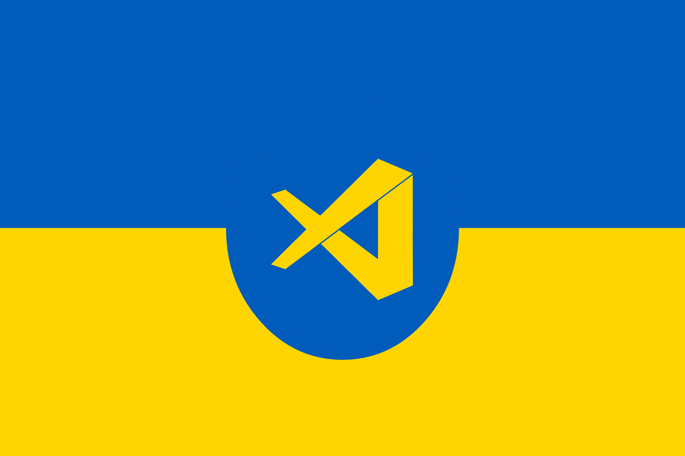

# Мовний пакет української мови для VS Code

Мовний пакет для української мови містить локалізацію інтерфейсу VS Code.

## Встановлення через Marketplace "VS Code"
Найпростіший спосіб — знайти розширення у вбудованому маркетплейсі VS Code.<br> Просто введіть у пошуку: ```Ukrainian Language Pack (Ovcharovcoder)```.<br>Встановіть пакет і насолоджуйтеся повністю українізованим інтерфейсом редактора.

**Активація української мови**

1. Натисніть `Ctrl+Shift+P` (або `Cmd+Shift+P` на Mac), щоб відкрити палітру команд.
2. Введіть `Configure Display Language` і виберіть цей пункт.
3. У списку виберіть `uk` (Українська) і підтвердіть вибір.
4. Перезавантажте VS Code, натиснувши **Restart**.

### Перевірка

Після перезавантаження, інтерфейс VS Code стане україномовним.

## Сумісність

Пакет підтримує VS Code версії 1.97.0 і вище. Перевірте свою версію в меню **Довідка > Про програму**.

## Переклад


- Андрій Овчаров
- Дата перекладу: 04.03.2025.
- E-mail: datoshcode@gmail.com


## ☕ Сподобався переклад українською? 
Пригостіть кавою через [PayPal](https://www.paypal.com/donate/?business=datoshcode@gmail.com)

<br>

**Дякую за підтримку та бажаю приємної роботи з VS Code українською!**



 ## Ліцензія

<a href="LICENSE">MIT</a>
